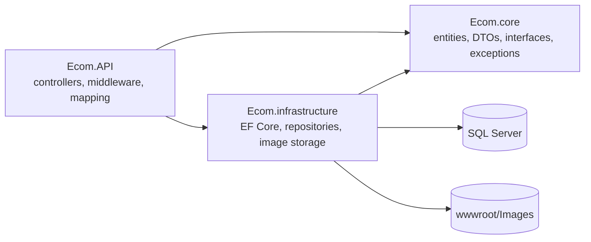
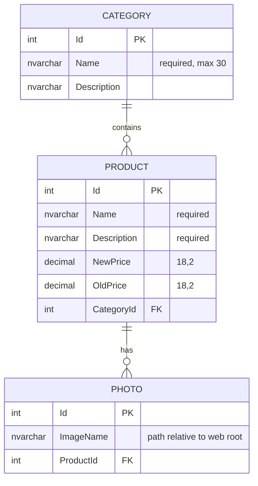

# Architecture

## Layers

Dependencies point inwards: `Ecom.API` and `Ecom.infrastructure` both depend on `Ecom.core`; `Ecom.core` depends on nothing but the ASP.NET shared framework (for `IFormFile`).

| Project | Responsibility |
|---|---|
| `Ecom.core` | `BaseEntity<T>`, `Product`, `Category`, `Photo`; request/response DTOs with validation attributes; `IGenericRepository<T>`, `ICategoryRepository`, `IProductRepository`, `IPhotoRepository`, `IUnitOfWork`, `IImageManagementService`; `NotFoundException`, `BadRequestException`, `ConflictException` |
| `Ecom.infrastructure` | `AppDbContext`, entity configurations, migrations, repository implementations, `ImageManagementService`, `AddInfrastructure()` DI registration |
| `Ecom.API` | Controllers, `ExceptionMiddleware`, `SecurityHeadersMiddleware`, AutoMapper profiles, `ApiResponse` envelope types, rate-limit/CORS/validation setup (`Extensions/`), `Program.cs` |

`Ecom.core` is compiled with `<Nullable>disable</Nullable>` on purpose: EF Core derives column nullability from it, so enabling it would change the schema.

## Request pipeline

Order matters; this is the order in `Program.cs`:

1. `SecurityHeadersMiddleware` - sets response headers.
2. `ExceptionMiddleware` - turns any exception into an `ApiErrorResponse`. `NotFoundException` becomes 404, `BadRequestException` 400, `ConflictException` 409, anything else 500 (logged).
3. Swagger / Swagger UI (Development only).
4. `UseStatusCodePagesWithReExecute("/errors/{0}")` - gives bodiless responses (unknown route, 405) the standard envelope via `ErrorController`.
5. HTTPS redirection.
6. Static files - serves `/Images/...`. It sits before the rate limiter, so image traffic is not counted.
7. CORS.
8. Rate limiter - fixed window per client IP.
9. Authorization (no policies yet).
10. Controllers.

## Data model

The relationships are configured by convention (`Product.CategoryId`/`Category`, `Product.Photos`/`Photo.ProductId`). Foreign keys cascade on delete, which is why the API refuses to delete a category that still has products (409) rather than silently deleting them and orphaning their image files. A seed row for each table is created by the migrations.

## Key flows

**Create product** (`POST /api/products`)

1. Model binding and validation (`AddProductDTO`); failures return 400 with field errors.
2. `ProductRepository.AddAsync` checks the category exists, maps the DTO to `Product`, and asks `ImageManagementService` to validate and store the files.
3. The product and its `Photo` rows are saved in a single `SaveChanges`. If that fails, the stored image files are deleted again.
4. The controller reloads the product with category and photos, maps it to `ProductDTO` and returns 201.

**Update product** replaces the photos only when new files are supplied. Old files are deleted only after the database save succeeds; new files are deleted if it fails.

**Delete product** removes the row (photos cascade), then deletes the image files best-effort.

## Design decisions

- **Repository + Unit of Work kept.** The existing structure was retained to keep the refactor reviewable. Repositories save immediately; `IUnitOfWork` is a thin aggregate that now gets its repositories through DI instead of constructing them.
- **Exceptions for control flow at the edges.** Controllers throw `NotFoundException` and friends; one middleware maps them. Controllers contain no `try/catch`.
- **One response envelope** for success and error, so the frontend has a single result shape (see [API.md](API.md#response-envelope)).
- **REST routes.** Resource-based routes and HTTP verbs replace the earlier `get-all`/`add-category` style.
- **Image storage behind an interface** (`IImageManagementService`) so it can later move to blob storage without touching repositories.
- **Built-in rate limiter** (`Microsoft.AspNetCore.RateLimiting`) instead of the earlier hand-rolled cache counter.

## Known limitations

- No authentication or authorization.
- No pagination, search or sorting on list endpoints.
- No automated tests (the refactor was verified by hand against a real SQL Server; see [REFACTORING.md](REFACTORING.md)).
- Rate limiting is per process and keyed on the connection IP; behind a reverse proxy configure forwarded headers first.
- Image type validation does not inspect file contents.
